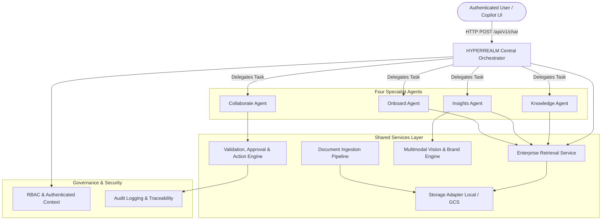

# HYPERREALM Backend — Agent Architecture & Knowledge Pipeline

This document details the architecture, design principles, and operational mechanics of the **HYPERREALM Four-Agent Orchestration Framework** and the **Multimodal Knowledge Pipeline**.

---

## 1. High-Level Architecture

HYPERREALM does not implement agents as isolated chatbots. Instead, all specialist agents operate as coordinated micro-services built on top of shared enterprise retrieval, authenticated access controls, multimodal vision, and a governed approval/execution workflow.



---

## 2. The Four Specialist AI Agents

The specialist agents are located in [`backend/app/agents/`](file:///c:/Users/hymat/OneDrive/Desktop/Hyperrealm/backend/app/agents/) (and exposed via the [`backend/agents/`](file:///c:/Users/hymat/OneDrive/Desktop/Hyperrealm/backend/agents/) package).

### A. Knowledge Agent (`knowledge_agent.py`)
- **Core Role:** Authoritative knowledge synthesis, personal workspace retrieval, and document intelligence.
- **Capabilities:**
  - Searches the authenticated employee's private **Personal Hub** without requiring re-uploads.
  - Queries published **Official Organizational Guidelines** (read-only for employees).
  - Summarizes complex KT documents and technical specifications into structured highlights and visual breakdowns.
  - Answers follow-up queries strictly grounded in retrieved passages with verifiable citations (`document_id`, `scope`, `version`, `passage`).
  - Identifies policy discrepancies (prioritizes published official guidelines over conflicting personal notes).

### B. Insights Agent (`insights_agent.py`)
- **Core Role:** Architectural governance, technical risk assessment, incident diagnostics, and brand auditing.
- **Capabilities:**
  - Evaluates engineering proposals against published architecture guidelines.
  - Returns structured recommendations: `Recommended`, `Recommended with Conditions`, `Needs More Information`, `Not Recommended`.
  - Ingests and investigates error logs and stack traces.
  - Matches previous incident reports and runbooks for proven resolutions.
  - Formulates evidence-based troubleshooting hypotheses when no prior incident matches.
  - Delegates design assets to the **Multimodal Vision Service** for brand compliance evaluations.

### C. Collaborate Agent (`collaborate_agent.py`)
- **Core Role:** Cross-functional coordination, SME discovery, Scrum meetings, and action tracking.
- **Capabilities:**
  - Discovers subject-matter experts (SMEs) across departments based on project ownership, skill sets, and document authorship.
  - Drafts meeting agendas and schedules Google Meet/Calendar syncs via integration adapters.
  - Extracts actionable decisions, blockers, and deliverables from meeting notes or transcripts.
  - Dispatches meeting proposals and task assignments through the approval workflow.

### D. Onboard Agent (`onboard_agent.py`)
- **Core Role:** Role-based developer onboarding, learning roadmaps, and compliance refreshers.
- **Capabilities:**
  - Tailors onboarding plans based on employee role (`software_developer`, `devops_engineer`, `qa_engineer`, `technical_lead`).
  - Maps mandatory vs optional learning resources and prerequisites.
  - Recommends targeted refresher training when relevant company guidelines are updated.
  - Tracks module completion progress without reporting unverified completions.

---

## 3. Central Orchestrator (`base_orchestrator.py`)

The **HYPERREALM Base Orchestrator** serves as the system's central nervous system:

1. **Intent Analysis & Routing:** Decides which specialist agent(s) to invoke based on user prompt semantics, or respects explicit user manual selection (`auto`, `knowledge`, `insights`, `collaborate`, `onboard`).
2. **Context Isolation:** Passes only the authorized employee identity, role, and scoped documents to downstream agents.
3. **Multi-Scope Retrieval:** Concurrently queries personal files, official standards, or historical incidents as required by the query.
4. **Action Proposal vs Execution Distinction:** Separates purely informational answers from consequential actions (e.g. creating meetings or assigning tasks), ensuring actions are submitted through approval controls.
5. **Multi-Agent Synthesis:** Consolidates outputs from multiple agents (e.g. Knowledge Agent finding an SME + Collaborate Agent proposing a calendar sync) into a unified, coherent response.

---

## 4. Multimodal Knowledge & Governance Pipeline

Located in [`backend/app/services/`](file:///c:/Users/hymat/OneDrive/Desktop/Hyperrealm/backend/app/services/):

### A. Document Ingestion Service (`ingestion.py`)
- **Scope Handling:** Ingests documents into either `personal` (employee drive) or `official` (authoritative guidelines).
- **Processing States:** Tracks lifecycle: `Uploaded` → `Processing` → `Indexed` (or `Failed`).
- **Multimodal Extraction:** Extracts plain text, markdown tables, and detects diagrams, charts, and embedded visual elements.
- **Supported File Types:** PDF, DOCX, TXT, PNG, JPEG, WebP.

### B. Enterprise Retrieval Service (`retrieval.py`)
- **Strict Scope Separation:**
  - `personal`: Only accessible by the document author/owner.
  - `official`: Authoritative company guidelines, viewable by all authenticated employees.
  - `project`: Documents authorized for specific project team members.
  - `historical`: Incident post-mortems and engineering runbooks.
- **Grounded Citations:** Every retrieved passage returns exact source metadata, document ID, title, scope, and section/page.

### C. Multimodal Vision & Brand Compliance (`vision.py`)
- **Brand Standards v2.1 Verification:** Audits visual assets (direct image uploads or diagrams extracted from documents) against authoritative brand identity guidelines.
- **Criteria Evaluated:**
  - **Color Palette:** Primary brand indigo (`#6366F1`) and allowable accent bounds.
  - **Logo Protection:** Minimum clearance space (≥24px on all boundaries).
  - **Confidentiality:** Mandatory enterprise confidentiality disclaimer on internal assets.
  - **Typography:** Outfit / Inter font hierarchy and minimum 4.5:1 contrast ratios.
- **Output:** Standardized report with status (`compliant`, `non_compliant`, `partially_compliant`, `unable_to_determine`), checks breakdown, observed visual evidence, guideline reference, and remediation steps.

### D. Validation, Approval & Action Execution (`workflow.py`)
- **Backend-Enforced Authorization:** Actions that alter company state (e.g. publishing guidelines, creating calendar invites, assigning tasks) require verification of user permissions.
- **Approval Lifecycle:** `pending` → `approved` / `rejected` / `cancelled`.
- **Action Execution:** Executes actions via integration adapters upon approval, ensuring idempotency and recording immutable audit logs.

### E. Storage Provider (`storage.py`)
- **Provider Pattern:** Abstract storage interface with automatic fallback:
  - **Demo Mode:** `LocalStorageAdapter` saves assets to local disk (`backend/uploads/`).
  - **Live Mode:** `GoogleCloudStorageAdapter` saves assets to configured Google Cloud Storage buckets (`GCS_BUCKET_NAME`).

---

## 5. Dual Operating Modes

HYPERREALM implements a **Demo-First Provider Architecture**:

| Capability | Demo Mode (`APP_MODE=demo`) | Live Cloud Mode (`APP_MODE=live`) |
| :--- | :--- | :--- |
| **GCP Credentials** | None required; starts out-of-the-box | Required (`GOOGLE_APPLICATION_CREDENTIALS` / ADC) |
| **Model Invocations** | Deterministic rule engine & seeded responses | Gemini Flash on Vertex AI (`GEMINI_MODEL=gemini-2.5-flash`) |
| **Document Storage** | Local file system (`backend/uploads/`) | Google Cloud Storage (`GCS_BUCKET_NAME`) |
| **Enterprise Retrieval** | SQLite Full-Text / Keyword vector indexing | Vertex AI Search data stores |
| **Multimodal Vision** | Deterministic brand compliance rule engine | Gemini 2.5 / 2.0 Flash Vision API |
| **Calendar & Meet** | Simulated integration adapter with demo link | Google Workspace / Calendar API |

---

## 6. Primary API Endpoints

### AI Orchestrator & Chat
- `POST /api/v1/chat` — Central orchestrator endpoint. Accepts prompt, optional agent selection, conversation ID, and returns grounded answers, citations, and proposed actions.
- `POST /api/v1/agents/{agent_name}/execute` — Direct invocation of a specialist agent (`knowledge`, `insights`, `collaborate`, `onboard`).

### Governed Knowledge Hub
- `GET /api/v1/knowledge/personal/documents` — Lists authenticated employee's private documents.
- `POST /api/v1/knowledge/personal/documents/upload` — Multipart upload to employee's private library.
- `POST /api/v1/knowledge/documents/{id}/summary` — Summarizes document with key takeaways and visual asset tags.
- `POST /api/v1/knowledge/documents/{id}/query` — Document-specific grounded Q&A with citations.
- `POST /api/v1/knowledge/images/audit` — Evaluates image asset for brand compliance.

### Authoritative Organizational Guidelines
- `GET /api/v1/official/documents` — Lists published official guidelines (accessible to all employees).
- `POST /api/v1/official/documents` — Upload and publish authoritative guidelines (Admin only).
- `GET /api/v1/guidelines/{id}/versions` — Immutable version history for an official guideline.
- `POST /api/v1/guidelines/{id}/versions` — Create a new version of an existing guideline (Admin only).
- `PATCH /api/v1/guidelines/{id}/archive` — Archive an official guideline (Admin only).

### Workflow & Actions
- `GET /api/v1/actions` — List recorded action executions and audit logs.
- `POST /api/v1/actions/execute` — Execute or request approval for an action.

---

## 7. Running the Backend & Tests

```bash
# Activate virtual environment
backend\venv\Scripts\activate   # Windows
# source backend/venv/bin/activate # Linux/macOS

# Run complete test suite (54 tests covering auth, data, rbac, and phase 4 pipeline)
python -m pytest backend/tests -v

# Run Phase 04 specific integration tests
python -m pytest backend/tests/test_phase4.py -v

# Start backend dev server on port 8000
python -m uvicorn backend.app.main:app --reload --port 8000
```
